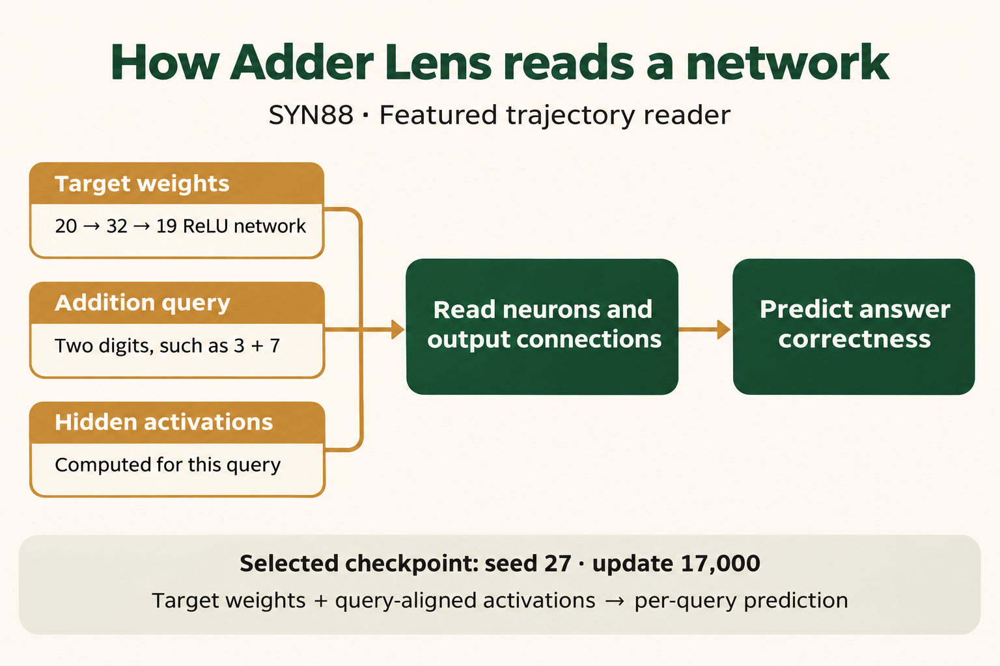

# Pretrained Adder Lens example

The featured checkpoint is **SYN88 trajectory seed 27, update 17,000**. Its saved validation objective is 0.0118825018171426, the lowest of the three released trajectory seeds (seed 17: 0.0119932298803155; seed 7: 0.0121899403533255). Each seed's checkpoint was selected by the frozen full-trajectory validation objective. The example uses this validation ranking to select its featured model.



## Run the reader

Install the [locked CUDA environment](DEPENDENCIES.md) with `uv sync --locked --extra hub`, then run these commands from the
repository root in PowerShell. They fetch the pinned featured reader and root 0000,
verify their hashes, and pass the resulting cached paths into the CUDA-default example:

```powershell
$lens = uv run --locked --extra hub python scripts/download_models.py --release synaptic-lens-adder --file syn88/lens-trajectory-seed-27.npz | ConvertFrom-Json
$target = uv run --locked --extra hub python scripts/download_models.py --release synaptic-lens-targets-adder --file syn88/population/root-0000.npz | ConvertFrom-Json
$checkpoint = $lens.files.'syn88/lens-trajectory-seed-27.npz'.path
$root = $target.files.'syn88/population/root-0000.npz'
uv run --locked python examples/demo_adder_lens.py --checkpoint $checkpoint --targets $root.path --targets-sha256 $root.sha256
```

All three commands use the same locked project environment. On other shells, copy the
`path` and `sha256` fields from the download commands' JSON output:

```console
uv run --locked python examples/demo_adder_lens.py --checkpoint PATH_TO_LENS --targets PATH_TO_ROOT --targets-sha256 TARGET_SHA256
```

The example runs on CUDA by default (or explicitly on CPU) and prints a compact JSON table for both target training rules at each of eight training ages. Each row shows native target addition accuracy, Lens-predicted correctness, Lens classification accuracy and Brier score across the 100 ordered digit pairs. Labels enter the metric calculation after Lens inference. The reader receives canonicalized target coefficients, arithmetic queries and query-aligned hidden ReLU activations.

The target family is a 20-input, 32-hidden-unit ReLU, 19-output MLP. Both rules share initialization; all ages of a root belong to the same partition. Root selection for a walkthrough should be fixed independently of its results, for example root 0000. The walkthrough describes that supplied sample.

## Historical benchmark evidence

The saved, reconciled SYN88 evaluation covers 512 root families, two rules and eight ages, for 819,200 query predictions. For the featured checkpoint it reports:

| Measure | Saved result |
| --- | ---: |
| Lens correctness-prediction accuracy | 99.6167% |
| Supported-cell macro same-query cross-root AUROC | 0.999659 |
| Macro Brier score | 0.002976 |
| Macro log loss | 0.011131 |

AUROC averages supported queries within rule-by-age cells; homogeneous query strata have no defined AUC. The benchmark measures transfer across independent target roots. The arithmetic inputs are the same complete 100-query suite used to train each target. These are historical results on the released population.

The inference export is 26,282 bytes, with SHA-256 `20cf06bf7599c457b56e42c381c7876ba2119985a98bb0a36a8633e3cffd614f`. See the [trajectory milestone](milestones/adder-trajectory.md), [artifact catalog](ARTIFACTS.md), and [generation protocol](milestones/syn88-generation.md) for input contracts and provenance. CPU and archived GPU arithmetic can differ slightly; the example reports its selected device and current calculation.
## Evidence identities

The historical table comes from `analysis-report-reconciled-v2.md` (SHA-256 `9583a778ed0707d825ef874750d85e17ed82f6bbc7109c93429d927fa3bdefb7`) and `analysis-results-reconciled-v2.json` (`3bc3678d5c23d991210ef99af8a84065e6d16cd873b1cff0ab77bef47b332045`) in the archived SYN88 attempt-01 evidence. The seed-27 selection receipt is `fits/trajectory/seed-27/latest.json` (`dd104556dec425a93762bf3131cc4bbdf987e2cf2bf78ae05446e46805ad4704`). These identify the source records used for this summary.

The walkthrough defaults to CUDA and fails clearly when CUDA is unavailable.
Add `--device cpu` for the small CPU-only alternative.

## Train your own

The [training walkthrough](TRAINING.md#train-an-adder-lens-and-compare-it-with-the-released-model)
downloads a small target population, trains the same Lens architecture and saves
a side-by-side comparison with this featured reader.
