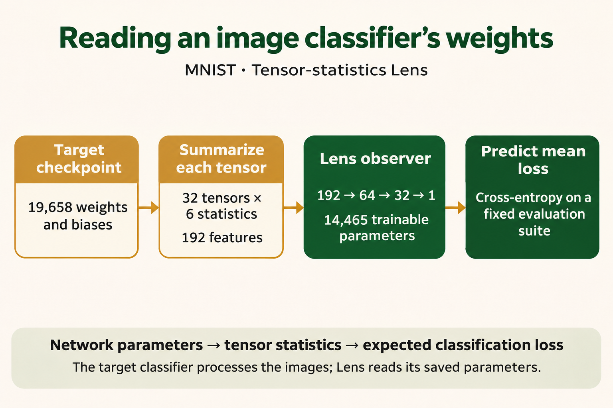

# Try the image-network Lens

The strongest released MNIST mean-loss reader uses **192 statistics of a
classifier's weights** to estimate its performance. The Lens is a small
192 → 64 → 32 → 1 network with 14,465 parameters.

In the saved development comparison, it achieved **0.17140 nats mean absolute
error**, compared with 0.83429 for the constant-mean baseline, a 79% reduction.
The comparison covered ten target states from two development roots.
[Methodology and full results](milestones/mnist-direct-weights.md) explain the
training, model selection and comparison models.



## Run it

From the repository root, install the [CUDA environment](DEPENDENCIES.md), including
its download client:

```sh
uv sync --locked --extra hub
uv run --locked --extra hub python examples/demo_image_lens.py
```

The example downloads one published Lens checkpoint, one target checkpoint
and the coordinate schema from pinned Hugging Face releases. It checks their
hashes, constructs the weight statistics, and runs Lens inference on CUDA.
No login, image dataset or training run is needed.

The default target is `mnist-d32-l2-root-1007` after 196 updates (one epoch).
Expected output includes:

```json
{
  "lens": "MNIST tensor-statistics Lens",
  "device": "cuda",
  "predicted_mean_cross_entropy_nats": 1.475825548171997
}
```

Cross-entropy measures the classifier's loss; lower values mean better
predictions. This number is the Lens's estimate for the selected checkpoint.
The command also prints model revisions and SHA-256 identifiers so you can
record precisely what ran. Small floating-point differences across devices
are normal.

## CPU and offline use

For a machine without CUDA, add `--device cpu`. To reuse downloaded files
without a network request, add `--local-files-only`. Use `--cache-dir PATH`
to choose the Hugging Face cache location.

The same prediction was verified on CUDA and CPU. The public inference
loader verifies checkpoint identity and uses restricted tensor loading.
See [downloads](DOWNLOADS.md) for release licenses, cache details and other
available checkpoints.
