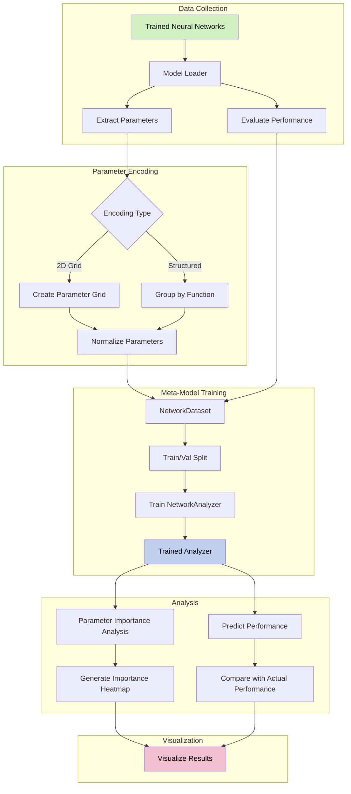

# SynapticLens: Core Concepts

[← Back to README] | [Extending SynapticLens →]

SynapticLens represents a novel approach to understanding artificial neural networks through meta-analysis of their parameters. This document explains the fundamental concepts that make SynapticLens work and how it approaches the challenge of neural network classification.

## System Architecture

The following diagram illustrates the SynapticLens architecture and data flow:

## The Meta-Learning Approach

SynapticLens uses a meta-learning paradigm where we train a neural network (the "analyzer") to understand and classify other neural networks by examining their parameters. This creates a recursive relationship where AI is used to understand other AI systems.

The core hypothesis behind SynapticLens is that:

1. Neural network parameters contain discoverable patterns that relate to their function
2. These patterns can be detected and classified using techniques similar to those used in image recognition
3. By learning these patterns, we can predict a network's performance without running it

## Parameter Space as a Data Domain

When we treat neural network parameters as data rather than as computational elements, we open up a new domain for analysis. Parameters are not random values but encode meaningful information about what the network has learned.

### Key Insight

Neural networks that perform similar functions develop similar parameter patterns, even if they were initialized differently or trained on different data distributions. These similarities exist at multiple levels:

- Statistical distributions of weights and biases
- Structural patterns in parameter matrices
- Relationships between parameters across layers

## Parameter Representations

SynapticLens transforms raw parameters into standardized representations that can be analyzed:

### 2D Grid Representation

The 2D grid representation converts all parameters into a single "image-like" grid:

1. Parameters are flattened into 1D vectors
2. These vectors are concatenated in a consistent order
3. The result is reshaped into a 2D grid
4. Values are normalized to make models comparable

This approach allows us to use convolutional neural networks to detect spatial patterns in the parameter space, similar to how CNNs detect features in images.

### Structured Representation

The structured representation preserves the relationships between parameters based on their function in the network:

- Weight matrices remain intact as 2D tensors
- Parameters are grouped by their type (weights, biases, normalization parameters)
- The hierarchical structure of the network is preserved

This approach enables more targeted analysis of how different parameter groups contribute to network function.

## Importance Analysis

Once the analyzer is trained to predict network performance, we can use it to identify which parameters most affect performance. This process is similar to techniques used in explainable AI:

### For 2D Grid Representation

1. Small regions of the parameter "image" are systematically masked (set to zero)
2. The analyzer predicts how each masking affects performance
3. A heatmap shows which regions most influence performance

### For Structured Representation

1. Entire parameter groups are systematically zeroed out
2. The analyzer predicts how each group's removal affects performance
3. The importance of each parameter group is quantified

## From Analysis to Classification

While the current version of SynapticLens focuses on predicting performance, its ultimate goal is to classify neural networks by their functional capabilities, not just their architecture.

The path to this goal involves:

1. Building a diverse dataset of neural networks with known functionalities
2. Training the analyzer to recognize the parameter patterns associated with these functionalities
3. Developing a classification system that can identify the capabilities of unknown networks

## The Power of Parameter Analysis

Parameter analysis offers several advantages over traditional methods of neural network evaluation:

1. **Efficiency**: Networks can be analyzed without running them on test data
2. **Insight**: Reveals which parts of a network are most important for its function
3. **Transferability**: Techniques learned on one type of network can be applied to others
4. **Discovery**: May reveal unexpected similarities between seemingly different networks

By understanding the patterns in neural network parameters, SynapticLens aims to provide deeper insights into how artificial intelligence works and how we can build more effective AI systems.

[//]: # (Links)
[← Back to README]:                 ../README
[Extending SynapticLens →]:         extending_doc
